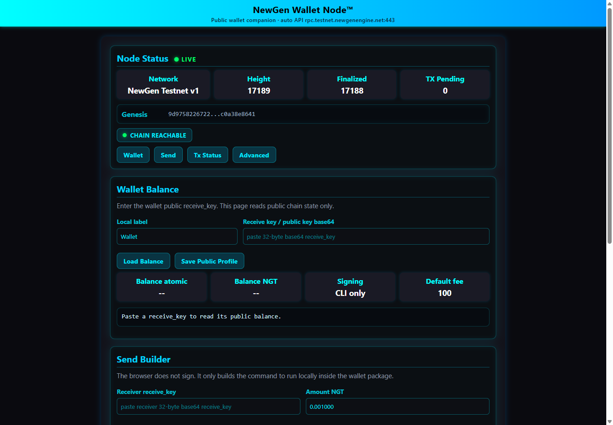

# 001 — L1 Runtime Progress

> **Historical testnet evidence.** The screenshots document June 2026 validation. The earlier log entries date to 4 May 2026. [V1 evidence report for October and November 2026](https://github.com/newgen-engine/newgen-l1-v1/blob/41f6557c45b87c7d9195b84166d4fed2d10077bd/evidence/EVIDENCE_REPORT.md)

## Overview

This note records selected observations from May and June 2026 NewGen L1 test runs.

* multi-node convergence
* finalized state progression
* client package startup
* wallet connectivity to live chain state
* peer-delivered block processing
* snapshot activity during runtime

---

## Runtime Validation Evidence

### Multi-Node Runtime Validation

In the 9 June 2026 comparison, three NewGen L1 node APIs reported matching chain state on the private testnet.

* identical network identifier
* chain height **17,103**
* finalized height **17,102**
* matching last block hash
* matching finalized hash
* mempool size of zero in the two responses in the three-node comparison with that field visible


An earlier response from Node A in the same screenshot reported height 17,102 and finalized height 17,101.

---

### NewGen Client Suite Startup

The June capture shows the NewGen Client Suite starting in wallet mode with the official testnet RPC configured as its fallback.

The package initialized successfully and launched its local HTTP interface.


The goal of the Client Suite is to provide a simple entry point for interacting with the network without requiring users to manually configure multiple runtime components.

---

### Wallet Node Live Runtime Page

The Wallet Node interface connected successfully to the network and retrieved live chain state.

Visible information includes:

* network identity
* chain reachability
* chain height **17,189** and finalized height **17,188** at capture
* genesis fingerprint
* zero pending transactions at capture



The browser interface reads public chain state only. Transaction signing is performed outside the browser through the wallet package.

---

## Earlier Runtime Excerpt

The following log entries are from an earlier NewGen L1 validation run on 4 May 2026.

Peer identifiers and block hashes have been shortened while preserving the runtime behavior being demonstrated.

```
ts=1777931850947 level=INFO node=A target=snapshot.export event=snapshot_export_summary node=A bundle_count=1 bundles=checkpoint-latest@height=461,window_from=0,chunks=8,reachable_only=true
ts=1777931879451 level=INFO node=A target=snapshot.export event=snapshot_export_summary node=A bundle_count=1 bundles=bootstrap-latest@height=461,window_from=0,chunks=8,reachable_only=true

ts=1777931880477 level=INFO node=A target=p2p.chain event=newblock_extends_tip height=462
ts=1777931880478 level=INFO node=A target=eco.ctrl event=fill_estimation_source height=462 source=user_tx_primary fill_ppm=0 ema_fill_ppm=0 mempool_before=0 mempool_after=0 eligible_before=0 eligible_after=0 selected_txs=0 recent_admitted=0 recent_fee_low_rejected=0 recent_fee_low_pruned=0 recent_ingress=0 stale_backlog_hold=false pressure_mempool_len=0
ts=1777931880483 level=INFO node=A target=p2p.chain event=new_block_intake state=applied block_hash=01fc1f93...85558d53 block_height=462 prev_hash=5b0bb735...d6bcc13 sender_peer=12D3KooW...ERjKRn local_height=462 disposition=applied reason_code=tip_extend boot_phase=steady_state sync_state=idle

ts=1777931910472 level=INFO node=A target=p2p.chain event=newblock_extends_tip height=463
ts=1777931910473 level=INFO node=A target=eco.ctrl event=fill_estimation_source height=463 source=user_tx_primary fill_ppm=0 ema_fill_ppm=0 mempool_before=0 mempool_after=0 eligible_before=0 eligible_after=0 selected_txs=0 recent_admitted=0 recent_fee_low_rejected=0 recent_fee_low_pruned=0 recent_ingress=0 stale_backlog_hold=false pressure_mempool_len=0
ts=1777931910478 level=INFO node=A target=p2p.chain event=new_block_intake state=applied block_hash=74a7e623...67158ac0b4 block_height=463 prev_hash=01fc1f93...85558d53 sender_peer=12D3KooW...ERjKRn local_height=463 disposition=applied reason_code=tip_extend boot_phase=steady_state sync_state=idle

ts=1777931940017 level=INFO node=A target=eco.ctrl event=fill_estimation_source height=464 source=user_tx_primary fill_ppm=0 ema_fill_ppm=0 mempool_before=0 mempool_after=0 eligible_before=0 eligible_after=0 selected_txs=0 recent_admitted=0 recent_fee_low_rejected=0 recent_fee_low_pruned=0 recent_ingress=0 stale_backlog_hold=false pressure_mempool_len=0
ts=1777931941229 level=INFO node=A target=snapshot.export event=snapshot_export_summary node=A bundle_count=2 bundles=bootstrap-latest@height=464,window_from=0,chunks=8,reachable_only=true;checkpoint-latest@height=464,window_from=0,chunks=8,reachable_only=true
```

<a name="current-observations"></a>

## Observations from the May and June 2026 tests

The May log records snapshot exports and a node applying blocks received from peers. The June screenshots show three nodes reporting the same tip and finalized block hashes at the recorded height, the client starting, and the wallet reading the testnet state.

---

## Notes

This evidence is intentionally partial.

Private infrastructure details, credentials, validator material, wallet material, API tokens, operational runbooks, and other sensitive information are not included.

These observations document private-testnet validation in May and June 2026. The original June note identified external follower operation, E2 Compute Hub integration, canonical worker projection, compute execution, and evidence finalization as topics for further evidence. [Current public status](../status/current-status.md)
